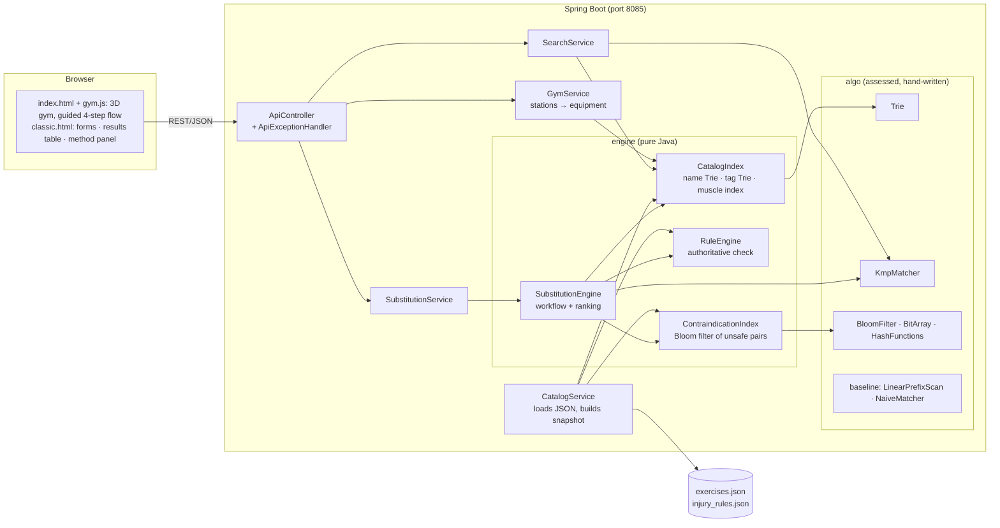

# Technical Report: Exercise Substitution & Injury-Safe Search

**Course:** Advanced Algorithms, CIA 3 (Real-World Application Project)
**Stack:** Java 17 · Spring Boot 3.2 (REST) · plain JavaScript frontend · JSON file store
**Assessed algorithms:** (1) Trie + KMP string matching, (2) Bloom filter, all implemented by hand in `backend/src/main/java/com/exsub/algo/`

---

## 1. Problem statement

A person with a minor injury (lumbar strain, shoulder impingement, patellar tendinopathy, and so on) often has one specific exercise in their programme that they should not do for now. They need a **substitute that trains the same muscles but is safe for their injury**. Today they ask a coach or search the web, and the answers are rarely ranked, explained, or checked against the injury.

The system takes **an exercise the user can't do** and **an injury/limitation tag**, plus optional parameters (number of results, a movement-cue keyword, keyword required, same equipment only). It returns:

1. a **ranked list of safe substitutes** with a score breakdown,
2. for each candidate, **which method decided it was safe** (Bloom negative, or Bloom positive cleared by the exact rule check),
3. the **rejected candidates and the confirmed rule each one violates**,
4. a **pipeline summary**: how the target was resolved, how many Bloom positives and negatives occurred, how many exact rule checks were run or skipped, and how many KMP character comparisons were made.

**Target users:** gym-goers managing a minor injury, and trainers/physiotherapists who want a fast reference tool.

### 1.1 Constraints

| Constraint | How it is met |
|---|---|
| Backend in Java / Spring Boot REST; all core logic in Java | `controller → service → engine → algo` layers; the frontend only renders JSON. |
| Assessed algorithms hand-implemented | `Trie`, `KmpMatcher`, `BloomFilter`, `BitArray`, `HashFunctions` are written from scratch. Java Collections appear only as infrastructure: a `TreeMap` as a trie node's child container, and a `long[]` as bit storage. No library trie, search, hash or Bloom-filter implementation is used. |
| Frontend without algorithm logic or precomputed results | The 3D gym (`gym.js`) and classic view (`classic.js`) only call the API and render the responses. Even each station's exercise list comes from the backend (`/api/gym/stations/{id}/exercises`, tag-trie lookups). |
| Bloom hit ≠ final answer | Every positive triggers `RuleEngine.evaluate(...)`. Only a confirmed violation rejects an exercise. This is enforced by test `S2`, which uses a deliberately saturated filter. |
| Database optional | JSON files on the classpath, overridable through environment variables. |
| Reproducible | Deterministic generator (fixed order, fixed seeds), Maven build, zero-dependency Node static server. |

### 1.2 Data (synthetic)

* **Exercise catalog** (includes 7 cardio-machine exercises: treadmill, rower, elliptical, stair climber, air bike; walking/running is grouped under the `carry` pattern as locomotion): 278 rows, of which **276 are unique** (2 duplicates are injected on purpose to show validation). Built from ~100 hand-written base movements × equipment variants × tempo/paused/single-arm variants. Every entry has a name, primary and secondary muscles, equipment, a movement pattern (push/pull/hinge/squat/carry/rotation/isolation), descriptive tags (e.g. `axial-loading`, `overhead`, `deep-knee-flexion-loaded`, `wrist-weight-bearing`), and a 250–450 character instruction text used by KMP.
* **Injury rule set**: 12 injuries, each with contraindications of kind `PATTERN`, `TAG` or `EQUIPMENT` and a human-readable reason. Examples: lumbar strain → avoid `axial-loading`, loaded spinal flexion and rotation; shoulder impingement → avoid `overhead`, `behind-neck`, `internal-rotation-loaded`; patellar tendinopathy → avoid `deep-knee-flexion-loaded` and `plyometric`. `finger-pulley-strain` deliberately has **zero** contraindicated catalog exercises (an edge case).
* The rules are **synthetic and only loosely inspired by common physiotherapy guidance**. They are not clinically sourced or reviewed. This limitation is stated in the README and the UI.
* Evaluating the rule engine over 276 × 12 pairs gives **312 contraindicated (exercise, injury) pairs**. These are the elements inserted into the Bloom filter.

---

## 2. System and API design



### 2.1 Substitution request pipeline

```
POST /api/substitutions {exercise, injuryTag, maxResults, keyword, requireKeyword, sameEquipmentOnly}
 │
 ├─ validate: catalog non-empty (503), exercise present, injury tag known (400 + valid tags), 1 ≤ maxResults ≤ 50
 ├─ resolve target:  id lookup → Trie exact name → Trie unique prefix → else 404/400 with Trie suggestions
 ├─ candidates:      exercises sharing ≥ 1 primary muscle with the target (muscle index)
 ├─ compile KMP:     failure function of the keyword, built once (O(m))
 └─ for each candidate c:
      if  !bloom.mightContain(c.id|injury)       → SAFE   (BLOOM_NEGATIVE, no rule evaluation)
      else violations = RuleEngine.evaluate(c, injury)        ← authoritative confirmation
           if violations ≠ ∅                     → REJECT (BLOOM_POSITIVE_RULE_CONFIRMED, reasons)
           else                                  → SAFE   (BLOOM_POSITIVE_RULE_CLEARED = false positive)
      apply filters (same equipment; KMP keyword required)
      score = 0.45·J(primary) + 0.15·J(secondary) + 0.20·[same pattern] + 0.10·[shared equipment] + 0.10·[KMP hit]
 sort by score desc, name asc → top maxResults
 status = OK  |  NO_SAFE_SUBSTITUTE (with an explicit reason: none exist / all unsafe / all filtered)
```

`J` is the Jaccard similarity |A∩B| / |A∪B|. The score is fully decomposed in the response (`breakdown`), and every accepted candidate carries an `acceptedBecause[]` list. This makes the ranking interpretable.

### 2.2 Endpoints

| Endpoint | Algorithm(s) |
|---|---|
| `GET /api/exercises/autocomplete?mode=name\|tag` | Trie prefix walk |
| `GET /api/exercises/text-search?q=` | KMP over all instruction texts (also reports naive comparison count) |
| `POST /api/substitutions` | Trie (target) + Bloom + RuleEngine + KMP |
| `GET /api/gym/stations`, `/api/gym/stations/{id}/exercises` | Tag-trie exact lookups on each station's equipment keys |
| `GET /api/catalog/stats` | Bloom m, k, n, fill, theoretical and measured FPP; trie sizes; load report |
| `GET /api/injuries`, `/api/health`, `/api/exercises/{id}` | — |

### 2.3 User interface

The primary UI is a **3D gym** (three.js) designed for first-time gym-goers, who often don't know exercise names. It opens at the front door, and a short scripted walk-in (doors slide open, the camera passes reception and looks at the free weights and the cardio row) recreates the feeling of entering a gym. The floor has four signed zones and 15 popular stations. Instead of a form, the user:

1. taps the machine they were going to use;
2. picks the exercise from a short list grouped by body area;
3. taps where it hurts on a body figure, with plain-language symptom descriptions (the `area` and `hint` fields on each injury rule);
4. gets up to 5 swaps. The stations holding them are highlighted in the room, and tapping a card flies the camera there.

The interface is deliberately minimal: one solid, high-contrast panel and one decision per step. **Back** and **Start over** are always visible, and the progress bar jumps to any earlier step with its answers kept.

**Station placement** (`GymService`) is computed on the backend. Stations are tried in order, and an exercise is placed at the first station whose equipment matches (exact tag-trie lookup) and, when the station lists keywords, whose name contains one at a word boundary (prefix search on the word-suffix name trie, e.g. `row` matches "Machine Seated Cable Row"). The stations therefore partition the catalog; a test checks that every exercise is placed exactly once. The algorithm details (trie resolution, Bloom negatives and positives, confirmed versus cleared, rule checks skipped) are behind a **"How we checked"** disclosure, so the method stays visible without cluttering a beginner's view. The original form UI (`classic.html`) keeps the full tables for expert users and examiners.

### 2.4 Data validation

| Case | Behaviour |
|---|---|
| Empty catalog (or unreadable file) | Every search/substitution returns **503 `CATALOG_EMPTY`**; `/health` reports `DEGRADED` and the load error. |
| Duplicate entries (same normalised name, or same id) | First occurrence kept. Each duplicate is listed in `loadReport.duplicates` (2 in the shipped data). |
| Invalid rows (no primary muscle, unknown movement pattern, missing text…) | Rejected and listed in `loadReport.invalid`. |
| Unknown or blank injury tag | **400 `UNKNOWN_INJURY_TAG`** with the list of valid tags. |
| Unknown or ambiguous exercise | **404 `EXERCISE_NOT_FOUND`** / **400 `AMBIGUOUS_EXERCISE`**, with trie-based suggestions. |
| No safe substitute | **200 with `status: NO_SAFE_SUBSTITUTE`**, a reason, and the full rejected list. Never an empty "OK". |
| Malformed JSON / bad parameters | 400 `MALFORMED_JSON` / `INVALID_PARAMETER` / `INVALID_MAX_RESULTS`. |

---

## 3. Algorithms: design and pseudocode

### 3.1 Trie (`algo/Trie.java`)

Each node has `children: Map<char, Node>` (a `TreeMap`, so depth-first traversal returns keys in lexicographic order), an `ids` set (non-null only on terminal nodes) and the stored `key`. Keys are normalised: lower-cased, trimmed, internal whitespace collapsed.

**Word-suffix indexing.** For autocomplete, each name is inserted together with every suffix that starts at a word boundary. *"Barbell Bench Press"* is inserted as `barbell bench press`, `bench press` and `press`. A prefix query therefore matches the start of **any word** of a name, while each lookup stays a pure prefix walk.

```
INSERT(key, id):
    k ← normalize(key);  node ← root
    for c in k:
        if c ∉ node.children: node.children[c] ← new Node
        node ← node.children[c]
    if node.ids = null: node.ids ← {}; node.key ← k
    node.ids.add(id)

SEARCH_PREFIX(prefix, limit):
    node ← root
    for c in normalize(prefix):
        node ← node.children[c];  if node = null: return []
    out ← [];  COLLECT(node, out, limit);  return out

COLLECT(node, out, limit):              // pre-order DFS, lexicographic
    if node.ids ≠ null: out.append((node.key, node.ids));  if |out| = limit: return
    for child in node.children (ascending char):
        if |out| = limit: return
        COLLECT(child, out, limit)
```

### 3.2 KMP (`algo/KmpMatcher.java`)

```
FAILURE(p[0..m-1]):                      // lps[i] = longest proper prefix of p[0..i] that is also its suffix
    lps[0] ← 0;  len ← 0;  i ← 1
    while i < m:
        if p[i] = p[len]: len ← len+1; lps[i] ← len; i ← i+1
        else if len > 0:  len ← lps[len-1]          // fall back, don't advance i
        else:             lps[i] ← 0; i ← i+1

SEARCH(t[0..n-1]):
    j ← 0                                // number of pattern chars currently matched
    for i in 0..n-1:
        while j > 0 and t[i] ≠ p[j]: j ← lps[j-1]
        if t[i] = p[j]: j ← j+1
        if j = m: report (i-m+1);  j ← lps[j-1]      // allow overlapping matches
```

The matcher is **compiled once per keyword** and reused for every candidate's instruction text. Comparisons are counted, so the response can show the work done.

### 3.3 Bloom filter (`algo/BloomFilter.java`, `BitArray.java`, `HashFunctions.java`)

* **Elements:** strings `"<exerciseId>|<injuryTag>"` for every contraindicated pair (n = 312 for the shipped data).
* **Sizing** for target false-positive probability p = 0.01:
  m = ⌈−n ln p / (ln 2)²⌉ = **2,991 bits (376 bytes)**, k = round((m/n) ln 2) = **7**.
* **Hash functions (own):** h₁ = FNV-1a 64-bit; h₂ = a multiply–rotate hash with a MurmurHash3-style `fmix64` finaliser and a different seed. Both have allocation-free versions for `CharSequence`, and unit tests check them against the byte-array versions and the published FNV test vectors.
* **k indexes** by Kirsch–Mitzenmacher double hashing: gᵢ(x) = (h₁ + i·h₂) mod m, i = 0..k−1. h₂ is forced odd, so the step is never zero.

```
ADD(x):            for i in 0..k-1: bits.set((h1(x) + i·h2(x)) mod m)
MIGHT_CONTAIN(x):  for i in 0..k-1: if !bits.get((h1(x) + i·h2(x)) mod m): return false   // DEFINITE
                   return true                                                              // POSSIBLE

SAFETY(c, injury):
    if !MIGHT_CONTAIN(c.id|injury): return SAFE (BLOOM_NEGATIVE)
    v ← RuleEngine.evaluate(c, injury)                 // authoritative, gives the reason
    return v = ∅ ? SAFE (BLOOM_POSITIVE_RULE_CLEARED) : UNSAFE(v) (BLOOM_POSITIVE_RULE_CONFIRMED)
```

---

## 4. Correctness (proof sketches)

**Trie.**
*Invariant:* the path from the root to node v spells a string s(v), and `v.ids ≠ null` ⇔ s(v) is an inserted key.
`INSERT` creates or follows exactly the nodes for the characters of k, so after the call s(node) = k and node is terminal. Nothing else changes, so the invariant holds by induction on the number of insertions.
`SEARCH_PREFIX` reaches the unique node v with s(v) = prefix, or proves that none exists. In that case no key has the prefix, because every key with that prefix would have to pass through v. Every key with the prefix is s(u) for some terminal u in v's subtree, and conversely. `COLLECT` visits that whole subtree (until the limit is reached), so the result is exactly the set of matching keys. Children are visited in ascending character order, and a node is emitted before its descendants. Pre-order DFS over an ordered tree is therefore lexicographic order (a key precedes its extensions).
*Empirical check:* property test T8 compares the trie against the linear-scan baseline on 2,000 random queries.

**KMP.**
*Invariant:* after processing t[i], j equals the length of the longest prefix of p that is a suffix of t[0..i].
When t[i] mismatches p[j], the next shorter candidate border is lps[j−1], by the definition of lps. Following the fallback chain therefore tries every border in decreasing length and skips none, so no occurrence can be missed. j = m exactly when p ends at i.
*Termination/complexity:* j increases by at most 1 per text character and each fallback decreases it by at least 1. Total fallbacks ≤ n, so comparisons ≤ 2n.
`FAILURE` is the same argument applied to p against itself.
*Empirical checks:* K7 runs 3,000 random cases against the naive matcher, and K8 asserts ≤ 2n comparisons on adversarial input.

**Bloom filter: no false negatives.** `ADD(x)` sets all k bits g₁(x)…g_k(x). Bits are never cleared. So for every inserted x, `MIGHT_CONTAIN(x)` finds all k bits set and returns true. A `false` result therefore guarantees x was never inserted (test B1, including after 5× over-saturation in B5).
*False positives:* after n insertions a given bit is still 0 with probability (1 − 1/m)^{kn} ≈ e^{−kn/m}, so the FPP ≈ (1 − e^{−kn/m})^k. It is minimised at k = (m/n) ln 2, which gives the sizing formula above.

**End-to-end safety.** The filter is built from exactly the pairs where `RuleEngine.evaluate` is non-empty, using the same rule set the request path uses.
* A **negative** means the pair is not in that set (no false negatives), so the rule engine would also say "safe". Skipping it is sound.
* A **positive** is never trusted: the rule engine is called, and its answer is final.

So the verdict for every candidate equals the rule engine's verdict. The Bloom filter only changes *how much work* is done, never *what answer* is given. Test S2 checks this directly: an 8-bit, fully saturated filter yields the identical result list, every accepted item is marked `RULE_CLEARED`, and every rejection carries a confirmed reason.
*Requirement:* the filter must be rebuilt whenever the rules or catalog change. This happens automatically, because the whole snapshot is built at load time.

---

## 5. Complexity

L = key/name length, P = prefix length, S = number of trie nodes in the matched subtree (≤ output-proportional when the limit is small), N = catalog size, K = keys in the trie (≈ 6N with word suffixes), n = text length, m = pattern length, k = number of hash functions, C = candidates per request, R = contraindications per injury.

| Operation | Time | Space |
|---|---|---|
| Trie insert | O(L) (· log σ for the TreeMap child lookup, σ ≤ 40 symbols → effectively constant) | O(L) new nodes worst case |
| Trie exact lookup | O(L) | — |
| Trie prefix search (top-k) | **O(P + S)**, independent of N | O(k) output |
| Trie build (all names + word suffixes) | O(Σ L²/avg-word-len) ≈ O(N·L) | O(total distinct prefixes) ≤ O(N·L²); measured 4,695 nodes for 276 names |
| Linear-scan baseline prefix search | **O(K·P)** + sort of matches | O(K) |
| KMP failure function | O(m) | O(m) |
| KMP search | **O(n)**, ≤ 2n comparisons | O(1) extra (+ output) |
| Naive search | O(n·m) worst case, ≈ O(n) on natural text | O(1) |
| Bloom add / query | **O(k + |x|)**: two hash passes over x, then k bit probes | — |
| Bloom memory | — | **m bits = −n ln p / (ln 2)²**, i.e. 9.6 bits per element at p = 1 %, **independent of key length** |
| HashSet baseline query | O(|x|) expected (hash + equals) | O(n·(|x| + ~60 B overhead)) |
| Rule engine evaluate | O(R) list/tag membership checks | O(rules) |
| Contraindication index build | O(N · I · R) for I injuries | m bits + exact set (eval only) |
| Substitution request | O(L) target + O(C·(k + R·b + n_instr)) where b = Bloom positive rate (only positives pay R) | O(C) |

---

## 6. Benchmarks

### 6.1 Methodology

* **Harness:** `com.exsub.bench.BenchmarkRunner` (plain `System.nanoTime`). Each experiment runs **2 warm-up rounds**, then reports the **median of 5 measured rounds**. A result sink prevents dead-code elimination.
* **Data:** `ExerciseCatalogGenerator.scaled(N, seed = 42)` at **N = 100, 1,000, 10,000, 50,000**. Each synthetic entry is a realistic base exercise with 1–2 random modifiers and a unique suffix, so muscles, tags and instruction texts keep realistic distributions. Contraindicated pairs come from the real rule set (≈ 1.13 × N pairs).
* **Workloads:**
  1. 500 autocomplete prefixes of length 1–6 taken from random word positions in real names, returning top-10 lexicographic matches (trie vs `LinearPrefixScan` over the same key set).
  2. Five realistic phrases scanned over all N instruction texts (KMP vs naive), plus an adversarial text `a…ab` with pattern `a²⁹b`.
  3. All N × 12 (exercise, injury) membership checks: Bloom filter vs `HashSet<String>` vs running the rule engine directly. Also measured: memory and the empirical FPP over every true negative.
  4. 40 random end-to-end substitution requests: the Bloom pipeline vs a rule-engine-on-every-candidate pipeline. The latter is simulated by a saturated 8-bit filter, so it uses the same code path.
* **Machine:** Apple Silicon (aarch64, 8 cores), Java 17.0.12, macOS. Absolute numbers vary by machine, and the trends are what matter. Full output: `docs/benchmark_results.md` / `.csv`.

### 6.2 Results

(Copied from `docs/benchmark_results.md`, generated by `BenchmarkRunner`.)

**Prefix search (top-10 autocomplete)**

| N exercises | indexed keys | trie nodes | Trie µs/query | Linear scan µs/query | speed-up |
|---|---|---|---|---|---|
| 100 | 607 | 7,852 | 5.01 | 19.42 | 3.9x |
| 1,000 | 6,110 | 54,625 | 1.40 | 43.50 | 31.2x |
| 10,000 | 61,333 | 374,831 | 1.46 | 455.79 | 312.0x |
| 50,000 | 305,910 | 1,432,433 | 1.09 | 2556.19 | 2349.1x |

**Phrase search, realistic text (per phrase, all N texts)**

| N exercises | text chars scanned | KMP ms/phrase | Naive ms/phrase | KMP comparisons | Naive comparisons | comparison ratio |
|---|---|---|---|---|---|---|
| 100 | 29,614 | 0.465 | 0.866 | 154,246 | 147,091 | 0.95 |
| 1,000 | 311,839 | 0.839 | 1.133 | 1,624,054 | 1,556,922 | 0.96 |
| 10,000 | 3,108,648 | 7.733 | 11.216 | 16,190,376 | 15,518,083 | 0.96 |
| 50,000 | 15,520,838 | 42.807 | 57.576 | 80,834,353 | 77,452,212 | 0.96 |

**Phrase search, adversarial text (`a…ab`, pattern `a²⁹b`)**

| text length | KMP ms | Naive ms | KMP comparisons | Naive comparisons | comparison ratio |
|---|---|---|---|---|---|
| 30,000 | 0.526 | 2.021 | 59,970 | 899,130 | 15.0 |
| 300,000 | 1.036 | 7.642 | 599,970 | 8,999,130 | 15.0 |
| 3,000,000 | 10.471 | 76.871 | 5,999,970 | 89,999,130 | 15.0 |
| 15,000,000 | 53.226 | 384.541 | 29,999,970 | 449,999,130 | 15.0 |

**Contraindication membership check (all N × 12 pairs)**

| N exercises | contraindicated pairs n | Bloom m (bits) | k | Bloom ns/check | HashSet ns/check | Rule-engine ns/check | Bloom memory | HashSet memory (est.) | memory ratio | target FPP | measured FPP |
|---|---|---|---|---|---|---|---|---|---|---|---|
| 100 | 105 | 1,007 | 7 | 440.1 | 56.9 | 185.5 | 128 B | 11.5 KB | 91.9x | 0.010 | 0.0064 |
| 1,000 | 1,158 | 11,100 | 7 | 140.8 | 61.0 | 99.0 | 1.4 KB | 123.5 KB | 90.9x | 0.010 | 0.0093 |
| 10,000 | 11,356 | 108,848 | 7 | 86.3 | 14.2 | 40.2 | 13.3 KB | 1.17 MB | 90.0x | 0.010 | 0.0096 |
| 50,000 | 56,590 | 542,419 | 7 | 82.2 | 14.4 | 42.6 | 66.2 KB | 6.01 MB | 92.9x | 0.010 | 0.0098 |

**End-to-end substitution request**

| N exercises | avg candidates / request | Bloom pipeline µs/request | Rule-only µs/request | rule evaluations avoided |
|---|---|---|---|---|
| 100 | 13 | 41.4 | 17.5 | 85.8% |
| 1,000 | 164 | 143.6 | 127.0 | 83.6% |
| 10,000 | 1,408 | 1385.0 | 956.0 | 90.2% |
| 50,000 | 7,368 | 6364.6 | 6224.9 | 86.9% |

On the shipped 276-exercise catalog: n = 312 pairs, m = 2,991 bits (376 B), k = 7, fill 52.3 %, theoretical FPP 1.00 %, **measured FPP 0.63 %** over all 3,000 true-negative pairs.

### 6.3 Analysis: when each approach wins or loses

**Trie vs linear scan.** The linear scan does O(K·P) work per keystroke, so its time grows linearly with N (19 µs → 2.6 ms, ×130 for ×500 data). Trie query time stays **flat at about 1–5 µs** because it depends only on the prefix length and the size of the output. At N = 100 the gap is only about 4× and both are far below anything a human could notice, so a naive scan is perfectly adequate for tiny catalogs. The trie pays for its speed with memory and build time: about 1.4 M nodes for 50k names, because of word-suffix indexing (each node a `TreeMap`). A compressed (radix) trie or array-based children would cut this, and is listed under future work. The trie query time even falls slightly as N grows, which is a JIT and cache-warmth effect: with bigger catalogs, 10 matches are found in a smaller part of a denser subtree.

**KMP vs naive.** On realistic English instruction text, a mismatch almost always happens at the first or second character, so the naive matcher is effectively linear. Both do about the same number of comparisons (ratio 0.96). KMP is still about 1.3–1.9× faster in wall time, which we attribute to its tight single-pass loop (no re-reading and lower-casing of text windows). On **repetitive/adversarial** input naive matching degrades to O(n·m). There KMP does **15× fewer comparisons and runs about 4–7× faster**, with time growing exactly linearly. KMP's advantage is a **worst-case guarantee**, and that matters when the input (user keywords, future free-text notes) is not under our control.

**Bloom filter vs HashSet vs direct rule evaluation.**
* **Memory: the Bloom filter wins decisively.** It uses 9.6 bits per element regardless of key length, which is about **90× smaller** than a `HashSet<String>` at every scale (66 KB vs 6.0 MB at 50k). That ratio holds as N grows, and it grows further with longer keys.
* **Time per check: the HashSet wins.** Java `String` caches its hashCode, so a repeated HashSet lookup costs one cached-hash bucket probe and one `equals` (about 15 ns). The Bloom filter must compute two 64-bit hashes over the roughly 25-character key and make 7 random bit probes (about 85 ns). Our in-memory rule engine is also cheap (about 40 ns, a few list checks).
* **FPP:** the measured FPP converges on the theoretical 1 % as n grows (0.64 % → 0.98 %). Small n is noisier because m is tiny and there are few negatives to sample. The 440 ns Bloom time at N = 100 is JIT warm-up noise on a very short run.
* **End-to-end:** the filter lets the pipeline **skip 84–90 % of authoritative rule evaluations**. Because those evaluations are themselves in-memory and cheap here, wall time is about the same, and slightly worse at large N (where the Bloom check adds ≈ 85 ns per candidate, while the confirmation path also pays string building for explanations).

**When the Bloom filter wins.** It wins when the authoritative check is **expensive** (a database, a remote clinical-rules service, or a disk-resident rule table), or when the exact set is **too large to keep in memory** (millions of exercise × injury × variant pairs on a mobile client). In those settings, skipping 80–90 % of authoritative lookups at a cost of about 85 ns each is a large gain, and the 90× memory saving lets the "possibly unsafe" index fit in cache or ship to a device.

**When it loses.** It loses when the exact set is small and already in memory, as in this coursework deployment. There a HashSet is faster and has no false positives. We kept the Bloom filter on the request path because it is the scalable architecture and because its behaviour (FPP, confirmations, avoided work) is measured and shown to the user. We do not claim a speed win at this scale.

---

## 7. Testing evidence

40 JUnit 5 tests, all passing (`mvn test`). Tests marked **[EDGE]** cover boundary cases.

* **Trie (8):** T1 empty trie [EDGE] · T2 single-character prefix [EDGE] · T3 exact full-string match [EDGE] · T4 absent/over-long prefix · T5 normalisation · T6 duplicate keys and shared keys · T7 limit · T8 property test vs linear scan (2,000 queries).
* **KMP (8):** K1 failure-function tables · K2 overlapping matches · K3 real instruction text · K4 no match, pattern longer than text, null text [EDGE] · K5 pattern = whole text, 1-character pattern [EDGE] · K6 empty pattern rejected [EDGE] · K7 property test vs naive (3,000 cases) · K8 ≤ 2n comparisons on adversarial input.
* **Bloom filter (8):** B1 no false negatives · B2 empty filter (zero contraindications) [EDGE] · B3 optimal m = 9,586 / k = 7 for n = 1,000, p = 1 % · B4 FPP at expected saturation within [0.5 %, 1.5 %], fill ≈ 50 % [EDGE] · B5 5× over-saturation → FPP > 40 %, still no false negatives [EDGE] · B6 m = 1 degenerate filter [EDGE] · B7 hash determinism + FNV-1a test vectors · B8 invalid parameters.
* **Workflow and validation (10 + 5 HTTP):** happy path verified against the rule engine; **saturated filter ⇒ no rejection without confirmation**; injury with zero contraindications; no safe substitute; unknown injury; unknown/ambiguous exercise; empty catalog; duplicate/invalid rows; KMP keyword filter; rule verdicts; and HTTP-level checks through MockMvc, including the gym-station endpoints.

---

## 8. Limitations

1. **Synthetic data.** The catalog and rules are generated or hand-written and are not clinically validated. Real contraindications depend on severity, stage of healing, pain response and individual factors that a tag-based rule set cannot capture. The tool is a reference aid, not medical advice.
2. **Rules are coarse.** Rules are binary (tag/pattern/equipment present ⇒ unsafe). There is no notion of load, range of motion, or "modified version is OK". Some sensible substitutes are therefore rejected, and some risky ones can pass if they are tagged incompletely.
3. **Bloom false-positive trade-off.** A lower p means a larger m (≈ 4.8 extra bits per element for each halving of p) and a higher k (slower checks). A higher p means more confirmations. Because every positive is confirmed, a false positive costs only time, never correctness. The filter cannot delete elements, so a rule change requires a rebuild (done at load time here; a counting Bloom filter would allow deletions). If the filter were ever built from a different rule set than the confirmer uses, the "negatives are definitive" guarantee would break. This is avoided by building both from one snapshot.
4. **Trie memory.** Word-suffix indexing with `TreeMap` children uses about 28 nodes per exercise. A radix trie or a sorted-array child representation would reduce this for very large catalogs.
5. **Ranking is heuristic.** The weights (0.45/0.15/0.20/0.10/0.10) are hand-chosen, not learned or validated with users.
6. **Benchmarks** are single-machine microbenchmarks without JMH. They are robust to warm-up through median-of-5, but absolute numbers are machine-specific. The HashSet memory figure is an analytic estimate.
7. **No persistence or auth.** The data is read-only at startup, which is appropriate for the scope.

**Future work:** a radix trie; a counting or cuckoo filter for updatable rules; a weighted severity model; fuzzy matching (edit distance) for typos; an evaluation of ranking with physiotherapists.

---

## 9. Individual contributions

> *To be completed by the team before submission.*

| Team member | Register no. | Contributions (algorithms, modules, tests, report sections) |
|---|---|---|
| Member 1: ______________________ | __________ | |
| Member 2: ______________________ | __________ | |

---

## 10. References

1. Knuth, D. E., Morris, J. H., Pratt, V. R. (1977). *Fast pattern matching in strings.* SIAM Journal on Computing 6(2).
2. Bloom, B. H. (1970). *Space/time trade-offs in hash coding with allowable errors.* Communications of the ACM 13(7).
3. Kirsch, A., Mitzenmacher, M. (2006). *Less hashing, same performance: building a better Bloom filter.* ESA 2006.
4. Fredkin, E. (1960). *Trie memory.* Communications of the ACM 3(9).
5. Cormen, Leiserson, Rivest, Stein. *Introduction to Algorithms*, 3rd ed., ch. 32 (string matching).
6. Fowler–Noll–Vo hash (FNV-1a) reference parameters; Appleby, A. MurmurHash3 `fmix64` finaliser.
